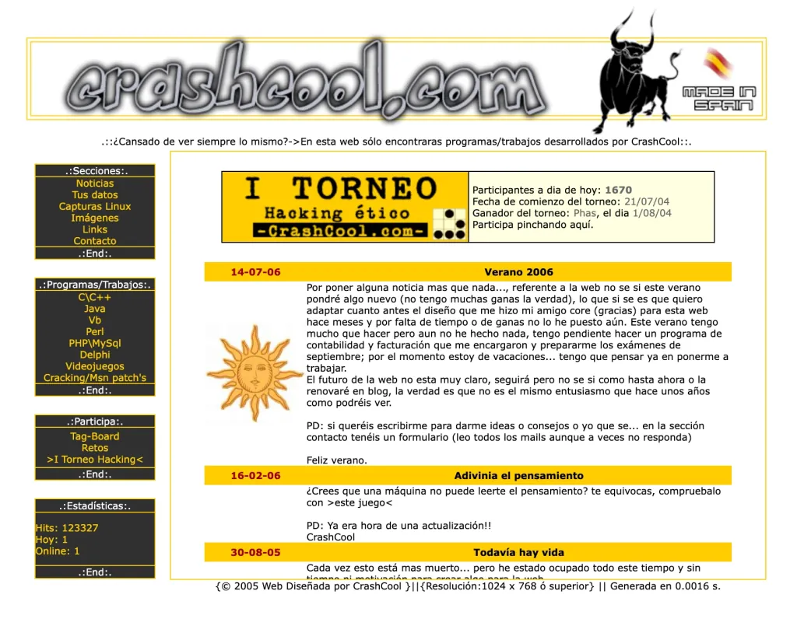

<h1 align="center">CrashCool.com</h1>

<p align="center">
  
</p>

Recuperación de **crashcool.com**, una web española de programación y hacking ético de mediados
de los 2000, conocida en la escena hispana por sus programas propios, sus retos y el I Torneo de
Hacking Ético de 2004. Esta versión reproduce el sitio tal y como estaba en febrero de 2006, a partir
de las capturas de [web.archive.org](https://web.archive.org/web/20060225062640/http://www.crashcool.com/).

En línea en <https://crashcool.com>.

## Sobre la recuperación

El HTML es el original archivado, con sus tablas, sus `<font>` y sus iframes. Las partes dinámicas
se han reescrito en PHP para que el sitio vuelva a funcionar: las estadísticas de visitas,
"Tus datos", el tag-board PhpTagCool, el torneo y "Adivina el pensamiento". Las descargas ya no
están disponibles.

## Estructura

```
public/      raíz web
secciones/   contenido que carga sec.php?menu=...&categoria=...
includes/    PHP común
docker/      configuración de Nginx
```

## Ejecutarlo

Con PHP 8:

```bash
php -S 127.0.0.1:8090 -t public -d default_charset=ISO-8859-1
```

Con Docker:

```bash
docker build -t crashcool .
docker run --rm -p 8090:80 crashcool
```

Y abre <http://127.0.0.1:8090>.

## Créditos

Contenido recuperado de [web.archive.org](https://web.archive.org/web/*/crashcool.com).
El tag del torneo es MiTagPHP de Cid (atomika.tk).
